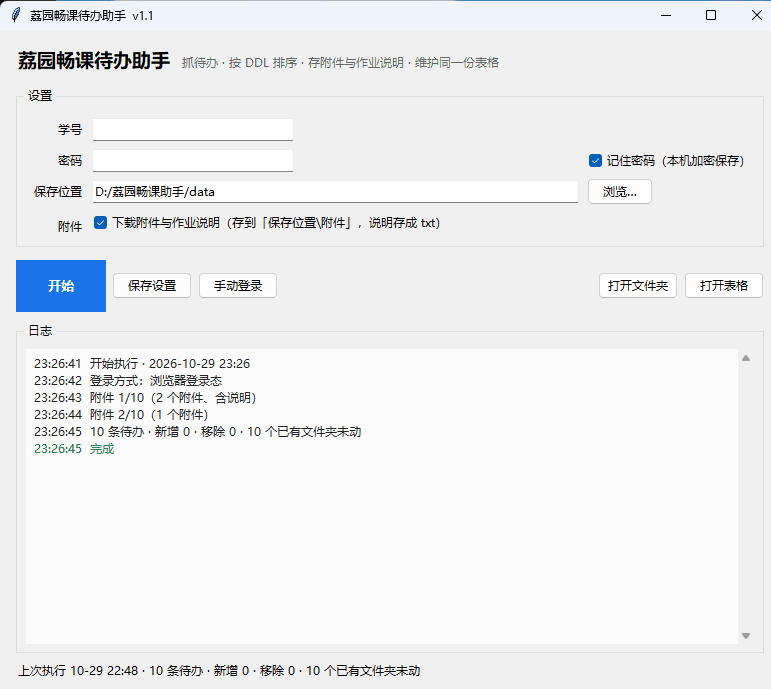

# 荔园畅课助手

抓取深圳大学荔园畅课（TronClass）首页待办，按截止时间排序，维护成一份 Excel，顺带把作业附件和作业说明下载到本地。



## 它做什么

- **抓待办**：任务名、课程名、截止时间，按 DDL 升序排好
- **维护同一份表**：每次运行都是增量更新——待办消失了就删行、下面的往上补；新待办按 DDL 插到对应位置，不会把整张表重写
- **下载附件**：按 `附件/课程名/作业名/` 分目录存好
- **保存作业说明**：老师没传附件、只写了段说明的，转成 `作业说明.txt` 放进同一个文件夹
- **不覆盖你写好的作业**：某个实验的文件夹已经存在，那条作业整个跳过，一个文件都不动
- **登录态自动续**：优先复用本地会话和浏览器登录态，失效了才用保存的密码自动登录

## 下载使用

1. 到 [Releases](../../releases) 下载最新的 `荔园畅课助手-vX.X.zip`
2. 解压到任意目录（路径别带特殊符号）
3. 双击 `荔园畅课助手.exe`

第一次运行填学号和密码，勾上「记住密码」，点「开始」。之后每次打开程序会自动跑一次。

密码用 Windows DPAPI 加密后存在 `data/cred.dat`，只有本机本账户能解开；拷到别的电脑上需要重新输一次。

## 从源码运行

需要 Python 3.10 以上（带 tkinter）。

```bash
python -m venv .venv
.venv/Scripts/activate          # Windows
pip install requests cryptography openpyxl

python src/app.py
```

打包成 exe：

```bash
pip install pyinstaller
python build/rebuild.py
```

产物 `荔园畅课助手.exe` + `_internal/` 会直接输出到项目根目录，约 46 MB。

## 实现要点

这个项目刻意**没有用 Selenium / Playwright**。浏览器自动化要在包里塞一个 Chromium，体积 300 MB 起步，而且容易因为页面改版而失效。改成纯 HTTP 之后整包 46 MB，启动也快得多。

### 登录：复刻前端加密

学校认证服务（金智 authserver）在提交前会由页面上的 `encryptPassword()` 处理密码：

```
明文 = 64 位随机字符 + 真实密码
密文 = base64( AES-128-CBC( key = iv = 页面里的盐, PKCS7填充, 明文 ) )
```

盐由服务端渲染进页面，每次请求都不同。所以登录流程是：先 GET 登录页拿到盐和 `execution`，本地算出密文，再 POST 这几个字段——

```
username   学号
password   上面算出的密文（注意表单里它的 id 叫 saltPassword，提交名却是 password）
cllt       userNameLogin
dllt       generalLogin
execution  页面里的隐藏字段
_eventId   submit
```

坑在于：页面有个 `checkForm()` 会在提交前拦截，看起来像「密码错误」的提示其实是前端校验失败。

### 登录态：直接读浏览器的 Cookie

Edge 的 cookie 存在 `Cookies` SQLite 里，值是用机器密钥加密的：

1. `Local State` → `os_crypt.encrypted_key`，去掉开头的 `DPAPI` 前缀，用 DPAPI 解出 AES 密钥
2. 用这个密钥对 `encrypted_value` 做 AES-256-GCM 解密（`v10` 开头，前 32 字节是 host 的 SHA-256，需要剥离）

只要能读到浏览器里已登录的 cookie，就不用再走一次密码登录。

### 四级回退

```
本地会话 data/session.dat  →  浏览器 Cookie  →  保存的密码自动登录  →  手动登录
```

每一级都用一次轻量请求（拿待办数量）验证是否真的有效，无效才降级。触发图形验证码时会退回手动登录。

### 表格为什么不会被写坏

- 增量比对而非整表重写，你的手动改动（比如自己加的备注列）不会被冲掉
- 写之前先探测文件是否被占用：如果是预览器之类的进程锁着，尝试释放；Excel / WPS 一律不动
- 落盘用「写临时文件 → `os.replace` 原子替换」，中途失败不会留下半张表
- 行高按 CJK 字符宽度实算换行行数，中文长标题不会被裁

### 附件去重只看文件夹

判断依据是 `附件/课程名/作业名/` 这个目录**存在且有内容**——满足就整条跳过，不比对文件大小。原因是大小比对反而危险：老师换了模板、文件大小一变就会重下，正好覆盖掉你改过的作业。

## 目录结构

```
src/
  app.py            tkinter 界面；带 --run 可无界面执行
  core_config.py    设置读写（便携：data/ 与 exe 同级）
  core_cred.py      密码加解密（Windows DPAPI）
  core_http.py      会话、四种登录方式、附件与说明抓取
  core_cookies.py   读取 Edge profile 的 cookie
  core_runner.py    一次完整流程：登录 → 抓待办 → 下附件 → 写表
  core_sheet.py     Excel 增量维护
  core_lock.py      文件占用探测与释放
build/
  rebuild.py        一键重新打包
  make_icon.py      纯 Python 生成 ICO
data/               运行时生成，已加入 .gitignore
```

## 注意

- 只适配深圳大学（`lms.szu.edu.cn` / `authserver.szu.edu.cn`），换学校用不了
- 附件不会重复下载。想重新下一份，把对应作业的文件夹删掉或清空再运行
- 抓取频率很低（每次运行就几个请求），但请不要改成高频轮询

## 免责声明

仅供个人学习与自用。请使用你自己的账号，不要用它访问他人数据，也不要分享登录凭据。因使用本工具产生的一切后果由使用者自行承担。

## License

[MIT](LICENSE)
